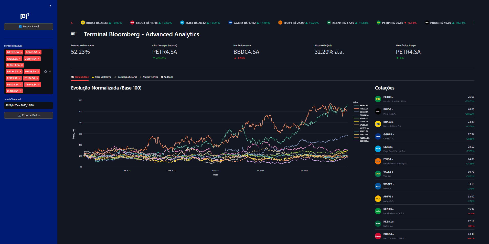
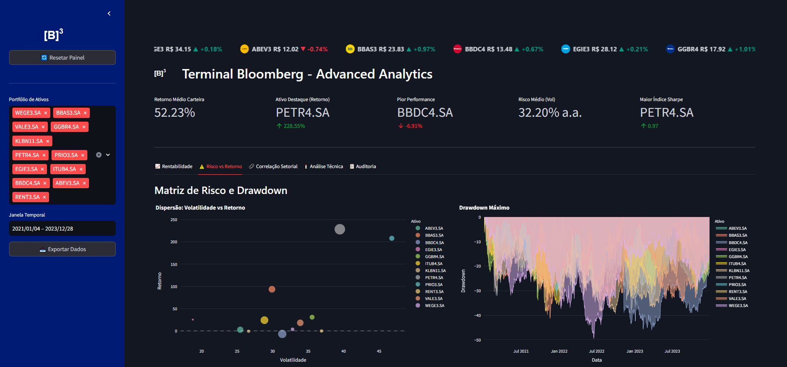
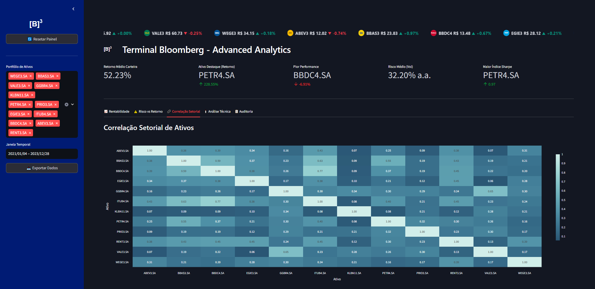
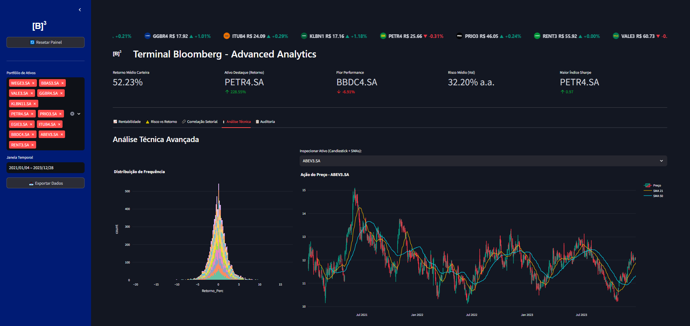
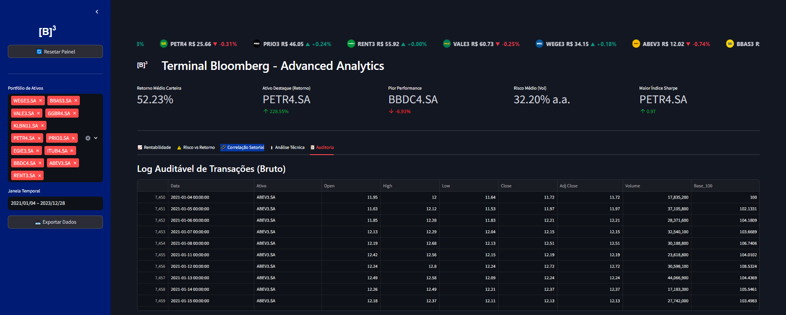
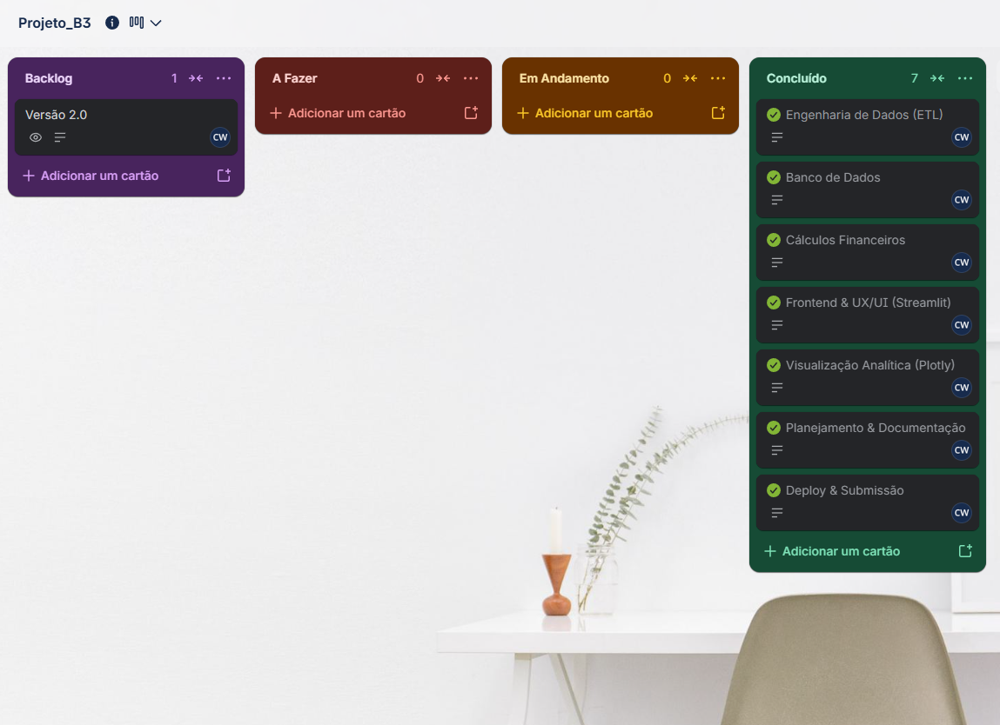

# 📊 Terminal Bloomberg B3 - Advanced Analytics

### 1. Título e Resumo Executivo
**Terminal Bloomberg B3 - Advanced Analytics**
Este projeto é um Data App interativo focado na análise quantitativa de 12 ativos de alta liquidez da bolsa brasileira (B3). A solução processa dados históricos de cotações para entregar um painel executivo que avalia rentabilidade, volatilidade, drawdown e correlação setorial, facilitando a visualização do balanço entre risco e retorno.

### 2. Contexto de Negócio e Pergunta Orientadora
No mercado de renda variável, o maior erro de um alocador de capital é olhar apenas para a rentabilidade absoluta e esquecer o risco assumido. 
A dor que este painel resolve é a falta de visibilidade rápida sobre a eficiência de um portfólio. As perguntas que guiaram o desenvolvimento foram: *Se eu tivesse alocado capital nestas 12 empresas no início de 2021, qual teria me entregado a melhor relação Risco-Retorno (Índice de Sharpe)? Como estas ações se correlacionam e qual o limite histórico de perda (Drawdown) de cada uma?*

### 3. Fonte de Dados e Licença
- **Origem:** Dados abertos extraídos via API pública do Yahoo Finance (`yfinance`) utilizando os tickers oficiais com sufixo `.SA`.
- **Período Histórico:** Janela estrita de **01/01/2021 a 31/12/2023** (3 anos completos), capturando o ciclo de mercado pós-pandemia e alta da inflação/juros.
- **Licença:** Dados de domínio público para uso acadêmico e analítico.

### 4. Pipeline de Engenharia de Dados (ETL)
A construção da base de dados seguiu um fluxo enxuto de extração e tratamento:
1. **Extração:** Script Python consumindo a API `yfinance` para baixar o histórico diário das 12 ações.
2. **Limpeza e Transformação:** Tratamento de valores nulos (dias sem pregão), padronização da coluna de data para `datetime64[ns]` e arredondamento de valores monetários.
3. **Modelagem:** Cálculo prévio do retorno diário e normalização da cotação para "Base 100", permitindo a comparação justa entre ativos de preços nominais muito diferentes.
4. **Carga:** Os dados tratados foram persistidos em um banco de dados PostgreSQL na nuvem (Supabase) e espelhados em um arquivo `.csv` local como mecanismo de contingência (*fallback*).

### 5. Dicionário de Dados
| Coluna | Tipo Primitivo | Descrição Financeira e Regra de Negócio |
| :--- | :--- | :--- |
| **Data** | `datetime64[ns]` | Data exata do pregão na B3. |
| **Ativo** | `string` | Ticker oficial da empresa listada na B3 (ex: PETR4.SA). |
| **Open** | `float64` | Preço de abertura da ação no início do pregão (R$). |
| **High** | `float64` | Cotação máxima atingida pela ação durante o pregão (R$). |
| **Low** | `float64` | Cotação mínima negociada durante o pregão (R$). |
| **Close** | `float64` | Preço de fechamento no final do horário regular (R$). |
| **Adj Close** | `float64` | Fechamento Ajustado (R$). Reflete o preço real após eventos corporativos (desdobramentos e dividendos). Usado para calcular o Retorno Diário exato. |
| **Volume** | `int64` | Volume financeiro/quantidade de papéis negociados no dia. |
| **Base_100** | `float64` | (Feature Engineering) O preço do primeiro dia do período é igualado a 100. Os dias seguintes mostram a evolução percentual acumulada. |

### 6. Tecnologias e Bibliotecas
- **Python 3.10+:** Linguagem base do projeto.
- **Pandas & NumPy:** Essenciais para a manipulação e vetorização de cálculos financeiros pesados (médias móveis, volatilidade anualizada, drawdown).
- **yfinance:** Biblioteca utilizada para a extração automatizada e em tempo real dos dados históricos de cotações dos ativos da B3 direto do Yahoo Finance.
- **Streamlit:** Framework escolhido para construir o frontend e o roteamento web do painel sem precisar de HTML/JS, permitindo o uso de `session_state` e cache nativo de forma ágil.
- **Plotly Express & Graph_Objects:** Utilizado pela interatividade e renderização superior de gráficos financeiros (Candlesticks, Drawdown e Heatmaps).
- **SQLAlchemy & Psycopg2:** Drivers de conexão resiliente com o banco PostgreSQL no Supabase.

### 7. Principais Resultados e Evidências Numéricas
- **Rentabilidade Geral:** A carteira entregou um retorno médio acumulado formidável de **52.23%** no triênio, com uma volatilidade média anualizada de **32.20% a.a.**
- **Destaque Absoluto (Alpha):** A **PETR4.SA** ancorou o portfólio, registrando impressionantes **+228.55%** de retorno acumulado. Em contraste, o ativo **BBDC4.SA** (Bradesco) amargou a pior performance (**-6.91%**).
- **Eficiência (Índice de Sharpe):** A **PETR4.SA** liderou a relação Risco-Retorno com o Maior Índice de Sharpe da carteira (**0.97**), provando ser a alocação mais eficiente face ao risco assumido.
- **Correlação Setorial:** O Heatmap revelou correlações perigosamente altas entre papéis do mesmo setor financeiro (ex: ITUB4 e BBDC4 com `0.77`), indicando baixa diversificação de proteção caso o setor sofra contrações sistêmicas.
- **Estresse de Mercado (Drawdown):** Identificam-se momentos em que os preços derreteram até **-50%** em relação ao topo anterior. O auge do estresse ocorreu em meados de 2022, impulsionado pela inflação e pelo ciclo de aperto monetário (alta da Selic).

### 8. Discussão e Limitações da Análise
É crucial pontuar que correlação e retornos passados não garantem lucros futuros. 
- **Viés de Janela Temporal:** O período de 2021 a 2023 foi fortemente marcado pela escalada da Taxa Selic e pela inflação global. Ativos que performaram mal sofreram em grande parte devido ao cenário macroeconômico contracionista, não necessariamente por problemas internos irreversíveis.
- **Falta de Indicadores Contábeis:** Este painel analisa puramente a ação do preço (Análise Quantitativa/Técnica). Inferir a solidez de uma empresa apenas porque o preço da ação subiu é um erro de causalidade; seria necessário cruzar estas métricas com o Balanço Patrimonial e DRE (Valuation fundamentalista) para determinar a saúde real do negócio.

### 9. Aplicação Profissional e Decisões de Negócio
No dia a dia corporativo, um gestor de portfólio usaria este painel para:
1. **Calibrar Posições (Stop Loss):** Observando o histórico no gráfico de Drawdown, o gestor sabe exatamente o nível máximo de perda que um ativo costuma sofrer antes de recuperar, evitando vendas irracionais em momentos de pânico do mercado.
2. **Hedge (Proteção):** Através do Heatmap de Correlação Setorial, é possível selecionar empresas que andam em direções opostas ou não correlacionadas para montar uma carteira blindada contra crises setoriais.
3. **Sinalização de Tendência:** O cruzamento das médias móveis (SMA 21 e 50 períodos) sobre os Candlesticks facilita o rastreio visual matemático de tendências e potenciais inversões de ciclo (bull/bear markets).

### 10. Demonstração do Data App (Streamlit)
- **Link em Produção:** [🔗 Acessar o Terminal B3 no Streamlit Cloud]

**Capturas de Tela:**











### 11. Como Executar Localmente
Para executar este projeto na sua máquina local:

1. Clone este repositório:
```bash
git clone [https://github.com/christianwislockioli-rgb/projeto_b3_senai.git](https://github.com/christianwislockioli-rgb/projeto_b3_senai.git)
```

2. Navegue até a pasta do projeto:
```bash
cd projeto_b3_senai
```

3. Instale as dependências:
```bash
pip install -r requirements.txt
```

4. *(Opcional)* Configure as credenciais do banco de dados na nuvem criando o arquivo `.streamlit/secrets.toml`.

5. Execute a aplicação:
```bash
streamlit run app.py
```

### 12. Estrutura de Pastas
```text
├── data/                  # Arquivo CSV de contingência (cotacoes_b3_2021_2023.csv)
├── docs/                  # Imagens (prints) Quadro Kanban e Gráficos
├── notebooks/             # AED .ipynb
├── src/                   # Arquivo .py projeto
├── .streamlit/            # Configurações de tema e credenciais (secrets.toml)
├── app.py                 # Código principal do Data App (Frontend e Lógica)
├── requirements.txt       # Lista de dependências e bibliotecas para o deploy
├── .gitignore             # Bloqueio de arquivos sensíveis e caches (Git)
└── README.md              # Documentação oficial do projeto
```

### 13. Gestão Ágil e Links do Projeto
Este projeto foi planejado e executado sob a metodologia ágil Kanban no Trello, fragmentando o escopo em entregas iterativas rigorosas (Planejamento ➔ ETL ➔ Banco de Dados ➔ Backend Analítico ➔ Frontend UX/UI ➔ Dataviz Plotly ➔ Deploy).

* **Quadro Kanban (Trello):** [🔗 Acessar Quadro de Gestão Ágil](https://trello.com/invite/b/6ae872ed82c1c9d6015ac7aa/ATTI03a713c031390a0f8d848e52359a184fAEF87A88/projetob3)


* **Evidência do Quadro de Tarefas (Print):**



* **Link da Aplicação em Produção:** [🔗 Streamlit Community Cloud](https://projetob3senai-nuy9cqvxkqu2plsls2djjq.streamlit.app/)
* **Pitch de Apresentação Executiva:** [🔗 Assistir ao Pitch (Vídeo)]

### 14. Autoria e Créditos
* **Desenvolvido por:** Christian Lorenzo Oliveira Wislocki
* **LinkedIn:** [🔗 Conecte-se no LinkedIn](https://www.linkedin.com/in/christian-wislocki/)
* **Agradecimentos & Referências Oficiais:**
  * Base de cotações históricas públicas da [B3](https://www.b3.com.br/pt_br/) consumida via `yfinance`.
  * Metodologia de UX Financeira baseada nos guias de contraste visual da Bloomberg e TradingView.
  * Desenvolvimento realizado no âmbito da Formação em Visualização de Dados e Business Intelligence (SENAI SC / Escola Digital).